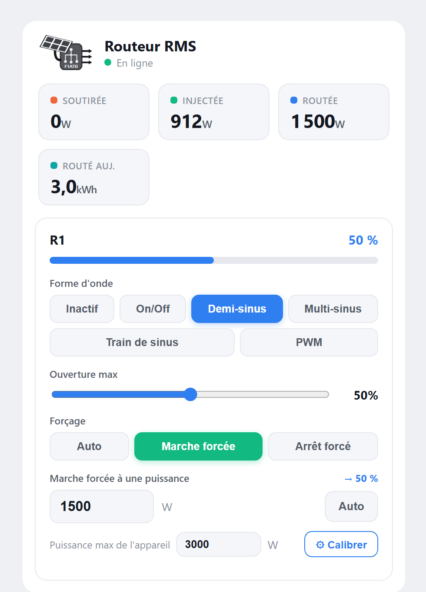
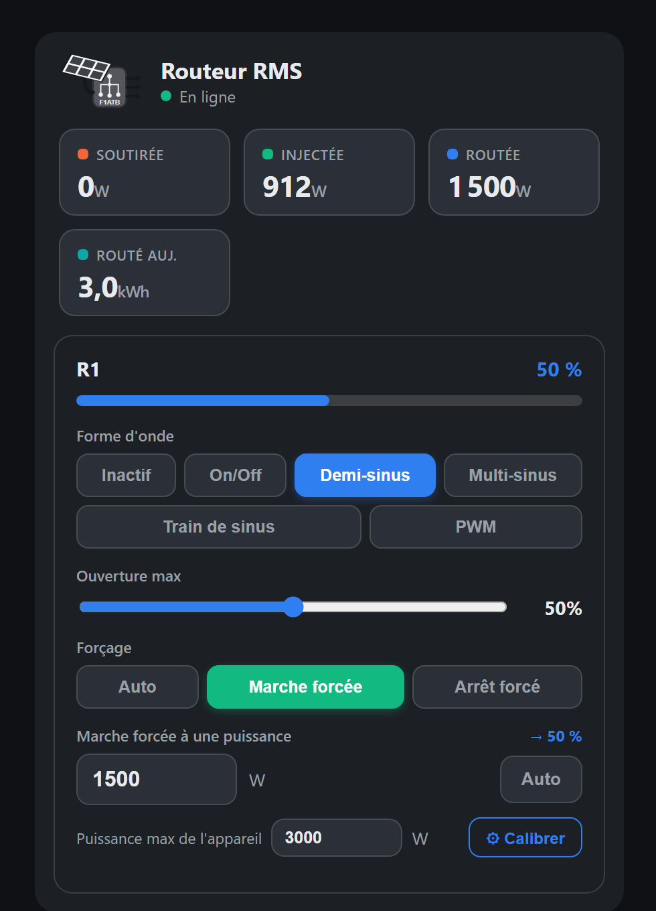
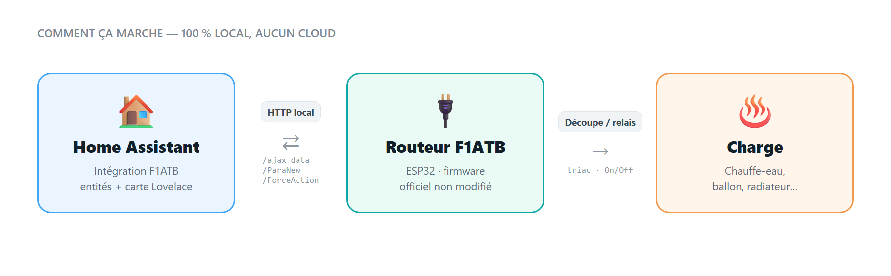

<p align="center">
  
</p>

<p align="center">
  <a href="https://hacs.xyz/"></a>
  <a href="https://github.com/PMSSI/Integration-f1atb/releases"></a>
  
  <a href="LICENSE"></a>
</p>

> 🇫🇷 Version française : [README.fr.md](README.fr.md)

**Home Assistant** integration for the [F1ATB solar router](https://github.com/F1ATB/Solar-Router-F1ATB)
(RMS / ESP32). It works with the **official firmware, unmodified**: everything happens on the Home Assistant
side, talking to the router through its **local HTTP API** (`local_polling`, 100 % local, no cloud).

The integration **reads** the measurements (powers, energies, routing opening, system info) **and controls**
the routing (waveform, max opening, forced on / off), with an **interactive Lovelace card** that follows
your theme. Entity names and the card are available in **French or English** (chosen at setup).

<table align="center">
  <tr>
    <td align="center"><b>Light theme</b></td>
    <td align="center"><b>Dark theme</b></td>
  </tr>
  <tr>
    <td></td>
    <td></td>
  </tr>
</table>

---

## ✨ Highlights

- **100 % official firmware**: nothing to flash or change on the router.
- **Dynamic entities**: created **only for active actions**. An action disabled (from HA *or* the router's
  web UI) has its entities removed automatically.
- **Full control** of each action: waveform, max opening, forced on / off.
- **Forced on at a given power (W)**: enter the power to route, the opening is computed for you;
  **one-click calibration** of the appliance max power.
- **Reliable energy**: "routed today" is integrated from the routed power by HA, and the lifetime counter is
  filtered so it never goes backwards when the router reboots (safe for the Energy dashboard).
- **Temperature probes**: configured channels (up to 4: DS18B20, external or MQTT) are exposed with their name.
- **Connectivity sensor** (`Connected`) to track when the router is running.
- **Resilient**: a missed poll does not make everything unavailable; a briefly missing action keeps its entities.
- **Styled Lovelace card**, loaded automatically, light / dark theme, French / English.

---

## 📋 Entities

### Per active action

| Entity | Type | Setting | Write |
|---|---|---|---|
| **Waveform** | `select` | Inactive / Phase cut (triac) or On-Off (relay) / Half-sine / Multi-sine / Sine train / PWM | `/ParaNew`, **persistent** |
| **Max opening (auto)** | `number` (0–100 %) | **ceiling of the automatic routing** (`Vmax`, all periods). Unavailable for a relay in On/Off mode, where the firmware uses `Vmax` as a power threshold in W | `/ParaNew`, **persistent** |
| **Forced-on opening** | `number` (0–100 %) | opening applied **while the routing is forced on** (`ForceOuvre`) | `/ParaNew`, **persistent** |
| **Override** | `select` | Auto / Forced on / Forced off | `/ForceAction` |
| **Forced-on power (W)** | `number` (W) | power to route → opening computed + forced on; **0 = auto** | `/ParaNew` + `/ForceAction` |
| **Max power** | `number` (W) | calibration: power at 100 % opening (stored in HA, manual entry allowed) | (stored in HA) |
| **Calibrate max power** | `button` | measures the max power automatically | `/ForceAction` |
| **Opening** | `sensor` (%) | current routing opening | read |

> Index 0 is the **triac** output (phase cut); the following indices are the **relays** (On/Off).

### Global sensors (always present)

| Entity | Unit | Detail |
|---|---|---|
| **Grid import** | W | power drawn from the grid |
| **Grid export** | W | power fed into the grid |
| **Routed power** | W | power sent to the load |
| **Routed energy today** | kWh | computed by HA by **integrating the routed power**, reset at midnight |
| **Routed energy total** | kWh | **lifetime** counter, filtered so it never goes backwards: use it in the Energy dashboard |
| **Temperature** (× configured channels) | °C | one entity per channel (0–3) configured on the router, with its name |
| **Connected** | on/off | router connectivity (stays available while offline) |

---

## 🚀 Installation (HACS)

1. HACS → **⋮** menu → **Custom repositories**
2. URL: `https://github.com/PMSSI/Integration-f1atb`, category: **Integration**
3. **Download** the integration, then **restart** Home Assistant
4. **Settings → Devices & services → Add integration → F1ATB Solar Router**
5. Enter the router's **IP address** (e.g. `192.168.1.101`) and choose the **language**

<details>
<summary>Manual installation (without HACS)</summary>

Copy `custom_components/f1atb/` into the `config/custom_components/` folder of your Home Assistant,
restart, then add the integration as above.
</details>

---

## ⚙️ Options

From **Configure** on the integration:

- **Language** of entity names and of the card: *Automatic* (Home Assistant language), *Français* or *English*.
  Changing it renames the entities (their entity IDs do not change). Select options are translated too:
  update automations that select an option by its text.
- **Polling interval** (default **5 s**): shorter = faster detection, more traffic.
- **Duration of a forced on / off** in minutes (default **720** = 12 h): applied when choosing
  "Forced on" / "Forced off"; the firmware counts down, then goes back to auto.

---

## 🎛️ Lovelace card

The `custom:f1atb-card` card is **loaded automatically** by the integration (nothing to install) and finds the
router by itself. It shows the power tiles, an **Online / Offline** indicator, temperature chips and, per
active action, the waveform (buttons), the max openings (sliders), the override and the forced-on power.
It follows the Home Assistant theme (light / dark) and the language chosen in the integration.

**Add it:** dashboard → **Add card** → search **"F1ATB Solar Router"** (with preview).

**Hide it while the router is off:** add a visibility condition on the card: state of `Connected` = `on`.

<details>
<summary>If the card does not show up in the picker</summary>

1. Clear the browser cache (**Ctrl+F5**) after restarting HA.
2. Otherwise add it as a **resource**: Settings → Dashboards → Resources → Add →
   URL `/f1atb/f1atb-card.js`, type **JavaScript module** → Ctrl+F5.

You can also build a dashboard with the **native cards** (selects show as drop-downs, numbers as sliders).
</details>

---

## 🔋 Energy tracking

- **Routed energy today** is computed **by Home Assistant by integrating the routed power** over time
  (trapezoids), reset at midnight. The firmware's own daily counter is **not** used: it over-counts when the
  router's power supply is cut (clock jumps at boot skew its integration).
- **Routed energy total** is the router's **lifetime** counter. At boot the firmware briefly reports a stale
  value (last midnight snapshot) or 0; the integration ignores readings that would make it go backwards, so
  the Energy dashboard does not count the whole lifetime total again after each reboot.

---

## ⚡ Forced on at a given power

Instead of an opening percentage, enter **the power to route** directly:

1. **Calibrate once** the appliance max power (power drawn at 100 % opening):
   - **Automatic**: **"Calibrate"** button → the integration opens to 100 %, lets the measurement settle,
     **averages the routed power over ~10 s** and stores it (~20 s, then back to auto; your forced-on
     opening is restored).
   - **Manual**: type the value in **"Max power"** (both methods remain available).
2. **Enter the power to route** in **"Forced-on power (W)"** (e.g. `1500`). The integration computes the
   opening (`power / max power × 100`, e.g. **50 %**), writes it and **forces the routing on**.
3. **Go back to auto** by entering `0` (or with the card's **Clear** button / the *Override* select).

> 💡 Calibrate when the appliance can actually draw power (e.g. cold water heater). The power / opening
> relation is assumed to be linear (a good enough approximation in practice).

---

## 🔎 How it works

<p align="center">
  
</p>

| Use | Endpoint(s) |
|---|---|
| Live measurements (powers, energies, temperatures) | `/ajax_data` |
| State of the **active** actions (drives the dynamic entities) | `/ajax_etatActions` |
| System (uptime, RSSI, memory, IP) | `/ajax_dataESP32` |
| Configuration (mode `Actif`, `ForceOuvre`, `Vmax`) | `/ParaFixe` |
| Writing a persistent setting | read `/ParaFixe` → change the field → post `/ParaNew` (serialised) |
| Forced on / off | `/ForceAction?NumAction=…&Force=…` |

No access key is needed (the ajax endpoints and `/ForceAction` do not check it). A persistent write does
exactly what the "Save" button of the router's web UI does.

> **Technical note:** `/ParaNew` must be sent with `Content-Type: text/plain`, otherwise the ESP32 parses the
> body as a form and **silently ignores** the JSON (the response is OK but nothing changes).

---

## 🩺 Troubleshooting

- **"Icon not available" on the integration**: normal for a custom integration (would need a
  `home-assistant/brands` PR). No effect on how it works.
- **Router powered off**: a **normal state**, not an error (typical if you switch its power supply). The
  integration **stays loaded**: `Connected` turns *off*, the other entities become *unavailable*, the card shows
  "Offline". **Everything fills in automatically** when it is powered on again.
- **Missed polls**: up to 3 consecutive missed polls are tolerated (last values kept) before going offline.
  An action that briefly disappears keeps its entities (unavailable); they are removed only when the action
  is **disabled** in the router configuration.
- **An action has no entities**: by design, only **active** actions have entities. Set its waveform to
  something other than Inactive on the router.

---

## 🧪 Tests

```bash
python tests/test_filters.py   # energy counter filter + translations, no Home Assistant needed
node tests/card_smoke.js       # card rendering with a fake hass (FR / EN / unavailable / pointer guard)
```

## 📦 Versions

See the [Releases](https://github.com/PMSSI/Integration-f1atb/releases). Update through HACS.

## 📄 License

[MIT](LICENSE).

---

*This project is not affiliated with F1ATB; it relies on the public API of the official firmware. Thanks to
[F1ATB](https://github.com/F1ATB/Solar-Router-F1ATB) for this great open-source solar router.*
